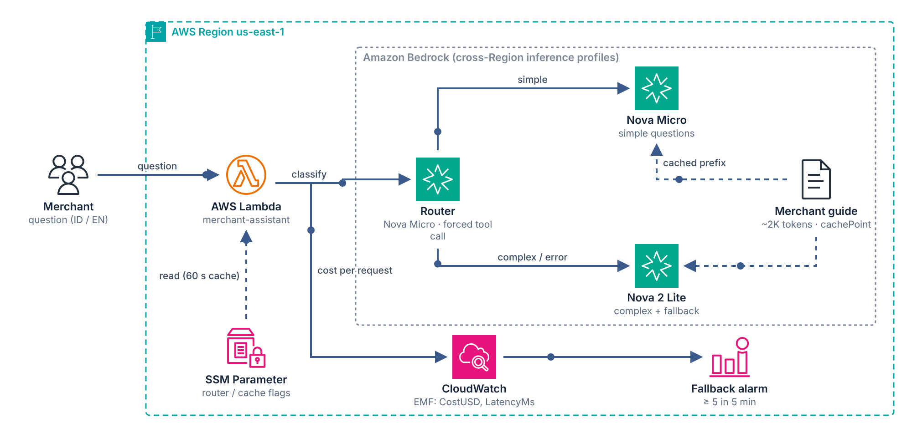

# Cost-aware LLM router on Amazon Bedrock

Send easy questions to a cheap model, hard ones to a stronger model, cache the long system prompt, and
measure whether any of it actually saves money without hurting answer quality.

This is a hands-on project from a merchant-support chatbot I'm developing for an e-commerce marketplace
of small Indonesian sellers. Merchants ask about fees, payouts, shipping, and returns in Indonesian, and
every answer must come from a ~2,500-token merchant guide (also in Indonesian). A sample guide and 30 test
questions ship with the repo, so you can run everything end to end yourself.

<picture>
  <source media="(prefers-color-scheme: dark)" srcset="docs/images/architecture-dark.png">
  
</picture>

What is in the repo:

| Path | What it does |
|---|---|
| `src/merchantbot/router.py` | Classifies a question as `simple` or `complex` with a forced tool call; falls back to the primary model on any error |
| `src/merchantbot/assistant.py` | Answers from the guide; puts a `cachePoint` after the static prefix |
| `src/merchantbot/evaluate.py` | Runs the 30-question golden dataset in one of five modes (four of ours plus Bedrock Intelligent Prompt Routing for comparison) and records quality, cost, latency |
| `src/merchantbot/report.py` | Comparison table and break-even point for the router |
| `src/merchantbot/handler.py` | Lambda handler with an SSM feature flag and EMF cost metrics |
| `infra/template.yaml` | SAM template: function, least-privilege IAM, log group, flag, fallback alarm |
| `data/golden.jsonl` | 30 questions with expected facts and a `simple`/`complex` label |

## Prerequisites

- An AWS account, Region **us-east-1** (the code uses the `us.` cross-Region inference profiles).
- An IAM identity that may call `bedrock:InvokeModel` on **Amazon Nova Micro** and **Amazon Nova 2 Lite**
  (plus **Nova Lite**, **Nova Pro** and `bedrock:ListPromptRouters` for the optional Intelligent Prompt
  Routing comparison). Serverless models in Bedrock are enabled by default since October 2025, so there
  is no model-access page to visit; only IAM policies or SCPs can block them.
- **Python 3.13** (the Lambda runtime; `sam build` without a container uses your local `python3.13`),
  AWS CLI v2, and (for the Lambda part) AWS SAM CLI. On macOS: `brew install python@3.13 awscli aws-sam-cli`.

```bash
python3.13 -m venv .venv && source .venv/bin/activate
pip install -r requirements-dev.txt
```

## 1. Check the pipeline offline (no AWS, no cost)

```bash
FAKE_BEDROCK=1 python -m pytest -q
FAKE_BEDROCK=1 PYTHONPATH=src python -m merchantbot.evaluate --mode baseline
FAKE_BEDROCK=1 PYTHONPATH=src python -m merchantbot.report --fake
```

The fake client is not a model; it only proves the plumbing works. Do not publish its numbers.

## 2. Run the experiment against Bedrock (a few US cents)

```bash
export AWS_REGION=us-east-1
scripts/run-experiment.sh
```

It runs the dataset through our four setups, then through Bedrock Intelligent Prompt Routing (the
default Nova router, Nova Lite / Nova Pro) as a reference, and prints a table like this:

| | All to primary | Primary + caching | Router | Router + caching | Bedrock IPR |
|---|---|---|---|---|---|
| Cost per 1,000 questions | | | | | |
| Golden pass rate | | | | | |
| Latency p50 / p90 | | | | | |
| Answered by the cheaper model | 0% | 0% | | | |
| Misrouted (vs. golden label) | – | – | | | |

Compare Bedrock IPR with the **Router** column (neither caches). Skip it with `SKIP_IPR=1`; if your
account has no default Nova prompt router or no Nova Lite/Pro access, the script carries on without it.
Point it at a router you configured yourself with `IPR_ROUTER_ARN=...`.

plus the router's **break-even point**: the share of questions that must go to the small model before
the router's own cost is paid back. Per-question details are in `results/<mode>.jsonl`; look at the
`failed` and `misroutes` lists in `results/<mode>.summary.json` before trusting the averages.

Run a single mode with `PYTHONPATH=src python -m merchantbot.evaluate --mode router --limit 5`.

## 3. Deploy the Lambda version

```bash
scripts/deploy.sh
# "What is the minimum withdrawal?"
scripts/ask.sh "Berapa minimal penarikan saldo?"
# "A buyer orders kerupuk for Rp200,000 plus Rp20,000 shipping and pays COD. What do I pay in fees?"
scripts/ask.sh "Pembeli pesan kerupuk Rp200.000 ditambah ongkir Rp20.000 dan bayar COD. Berapa biaya yang saya bayar?"
```

The response shows the route, the model that answered, and the cost of that request.

### Verify

Per-request metrics land in CloudWatch under the `MerchantAssistant` namespace (`CostUSD`,
`LatencyMs`, `CacheReadTokens`, `RouterFallback`, by `Route`). To see cost by model in Logs Insights
(log group `/aws/lambda/merchant-assistant-assistant`):

```
fields @timestamp, Route, model, CostUSD, LatencyMs, CacheReadTokens
| filter ispresent(CostUSD)
| stats count() as requests, sum(CostUSD) as cost_usd, avg(LatencyMs) as avg_ms by model
```

Switch the router off without a deploy (picked up within a minute):

```bash
aws ssm put-parameter --name /merchant-assistant/router-flags --overwrite \
  --value '{"router": false, "cache": true}'
```

## 4. Clean up

```bash
scripts/cleanup.sh
```

This deletes the function, IAM role, log group, SSM parameter, and alarm. Nothing in the stack costs
money while idle; the only charges are Bedrock tokens per request and CloudWatch logs.

`sam deploy --resolve-s3` also creates an `aws-sam-cli-managed-default-…` bucket for build artifacts.
`sam delete` empties this stack's objects but keeps the bucket; delete it in the S3 console if you don't
use SAM elsewhere.

## What it costs

Rough numbers with us-east-1 list prices (check the pricing page; your token counts will differ):

| Activity | Estimate |
|---|---|
| One full `run-experiment.sh` (5 modes × 30 questions: 150 answers + 60 router calls) | about US$0.10–0.20 |
| Lambda, SSM, logs during a short test | effectively $0 (free tier / a few cents) |
| CloudWatch alarm | US$0.10 per alarm-month, prorated; gone after cleanup |
| Offline tests (`FAKE_BEDROCK=1`) | $0 |

So following the whole guide, with a few re-runs, stays well under US$1.

## Things that tripped me up

- **`cacheWriteInputTokens` is 0 and nothing is cached.** Amazon Nova needs at least ~1K tokens before a
  `cachePoint`; a shorter prefix is silently ignored. Anything that changes per request (the question,
  retrieved chunks, today's date) must come after the checkpoint, or every request writes a new cache.
- **Cache hits vary.** With a cross-Region inference profile, a request may be served from another
  Region that has no cache yet. Judge caching by `cacheReadInputTokens` over many requests, not one call.
- **`AccessDeniedException` from Lambda.** A cross-Region profile needs `bedrock:InvokeModel` on the
  profile *and* on the foundation model in every Region it can route to (see the template).
- **The router is not free.** It adds one small-model call and some latency to every request. Use
  `report.py`'s break-even line before keeping it.

## Limits

- Grading is keyword-based: good enough to catch missing facts and wrong numbers, not tone or
  completeness. For a real launch, add human review or an LLM-as-a-judge pass on a sample.
- 30 questions is a smoke test, not a benchmark. Re-run with your own traffic before deciding.
- Prices live in `src/merchantbot/data/pricing.json`; check the
  [Amazon Bedrock pricing page](https://aws.amazon.com/bedrock/pricing/) before you publish numbers.

## License

MIT-0. The merchant guide and test questions are sample data for this project.
